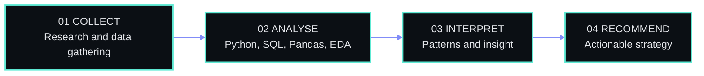

<div align="center">


<br/><br/>

<a href="https://github.com/firozcodes"></a>
<a href="https://linkedin.com/in/firoj_"></a>


</div>

<br/>


Analytical and results-driven **B.Tech Data Science** student with hands-on experience in data analysis, research, problem-solving and machine learning. I interpret complex information, identify patterns and turn them into actionable recommendations.

Running a digital platform gave me practical experience managing multiple tasks, content strategy and audience analytics. My focus is moving toward **business strategy, consulting and project coordination**.

<br/>


```console
firoj@analytics:~$ whoami
firoj | b.tech data science, 2023 - 2027

firoj@analytics:~$ cat focus.txt
business analytics, strategy, consulting

firoj@analytics:~$ youtube --subscribers
1.3M+  (FirozShortss)

firoj@analytics:~$ status
open to internships  [ available ]
```

<br/>


<div align="center">

**PROGRAMMING**<br/>


**DATA ANALYSIS**<br/>


**VISUALIZATION**<br/>


**MACHINE LEARNING**<br/>


**TOOLS**<br/>


</div>

<br/>


| | |
|---|---|
| **Analytical Thinking and Problem-Solving** | **Research and Data Interpretation** |
| **Written and Verbal Communication** | **Project Coordination and Time Management** |
| **Attention to Detail** | **Team Collaboration** |

<br/>




<br/>


Founded and grew the YouTube channel **FirozShortss** to **1.3M+ subscribers**, applying audience analytics and data-driven content strategy to sustain long-term growth and engagement.

Consistent content creation and presentations built strong public speaking, communication and personal branding skills.

<br/>


| | |
|---|---|
| **Education** | B.Tech in Data Science, Teerthanker Mahaveer University, Moradabad, UP (2023 - Expected 2027) |
| **Certifications** | IIT Bombay: C Programming  /  Spoken Tutorial: HTML  /  Great Learning: Soft Skills |
| **Languages** | Hindi (Native)  /  English (Professional)  /  Urdu |

<br/>


<div align="center">


</div>

<br/>

<div align="center">

<a href="https://github.com/firozcodes"></a>
<a href="https://linkedin.com/in/firoj_"></a>

<sub>Open to consulting, analytics and strategy internships.</sub>

</div>


